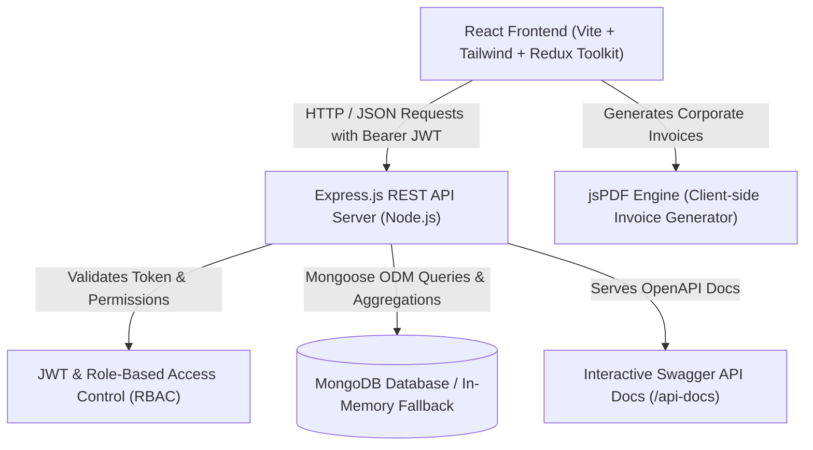
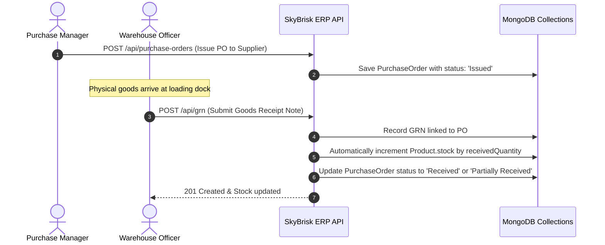
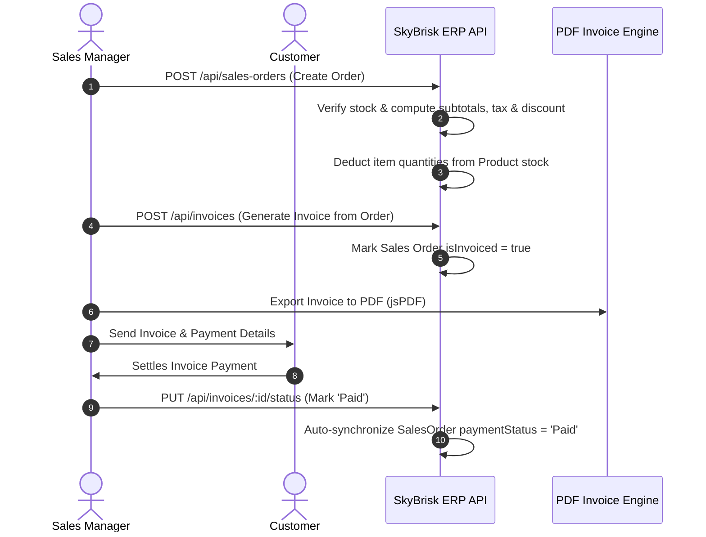

# SkyBrisk ERP System Architecture

## 1. High-Level System Architecture

## 2. Core Business Workflow: Procurement to Inventory (GRN)

## 3. Order-to-Cash Workflow (Sales to Invoicing)

## 4. Role-Based Access Control (RBAC) Matrix

| Module / Endpoint | Admin | Sales | Purchase | Inventory |
|---|:---:|:---:|:---:|:---:|
| **Dashboard KPIs & Charts** | Full Access | Full Access | Full Access | Full Access |
| **Products Catalog** | Read / Write | Read Only | Read / Write | Read / Write |
| **Customer Directory** | Read / Write | Read / Write | Read Only | Read Only |
| **Supplier Directory** | Read / Write | Read Only | Read / Write | Read Only |
| **Sales Orders** | Full Access | Full Access | Read Only | Read Only |
| **Purchase Orders** | Full Access | Read Only | Full Access | Read Only |
| **Goods Receipt Note (GRN)** | Full Access | Read Only | Full Access | Full Access |
| **Invoicing & Billing** | Full Access | Full Access | Read Only | Read Only |
| **User Management (RBAC)** | Full Access | No Access | No Access | No Access |
